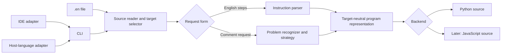

# EN Language Architecture Roadmap

> **For agentic workers:** Implement one milestone at a time. Use `superpowers:executing-plans` for an approved milestone, and keep its checklist and evidence in a separate execution record.

**Goal:** Let a beginner write supported English instructions or a supported problem request in a `.en` file and obtain editable code entirely offline, starting with Python.

**Architecture:** EN-Library owns one deterministic interpreter. It reads `.en` source, selects either the instruction-language parser or the problem-request recognizer, converts the result to a target-neutral program representation, and passes that representation to a language backend. The `en-language` repository owns the language contract, examples, and editor integrations. The command line is the common entry point for editors and future host-language adapters.

**Tech stack:** Python 3.10+ standard library for the interpreter and CLI; existing Node.js VS Code extension; `unittest` and independent example programs for verification.

**Existing design:** [language specification](../../SPEC.md), [offline interpreter plan](2026-10-20-offline-interpreter.md), and [repository split design](../specs/2026-10-19-library-language-repository-split-design.md).

## What the diagram means in the product

- `.en` is the source language. It can express program steps, including existing class and method forms, or a high-level request in comments.
- A directive in the `.en` file selects the output language. Keep the existing `import codeinpython library` spelling as a Python alias. Define one canonical target syntax before adding another backend.
- `import codeinenglish` in a Python program loads the package API; Python does not execute comments on import. A Python integration must explicitly call an API such as `codeinenglish.generate_file(...)` or invoke the CLI.
- `pip install` installs the interpreter and CLI for any user with Python. Producing JavaScript or another target does not require importing a Python module from that target language. Later adapters can call the CLI.
- Offline operation means no model, hosted API, network access, downloaded weights, or third-party runtime dependency during translation.
- Deterministic recognition can cover a growing set of English requests, but cannot promise correct code for every possible comment. Unsupported or ambiguous requests must fail with a useful explanation.

## Current starting point

- At planning time, EN-Library had an instruction parser, object-oriented constructs, 15 documented problem families, Python generation, and `generate_file` only in a local staging copy. The language workspace had examples and a VS Code Run extension.
- At planning time, 110 Python tests, 19 extension tests, and all 19 `.en` examples passed locally.
- Both repositories have since been recovered and the verified baseline has been pushed to `feat/en-architecture` branches. The default branches have not been changed.

## Global constraints

- Keep one maintained interpreter implementation in `EN-Library`; do not copy it into editor extensions or `en-language`.
- Preserve existing `.en` examples, `translate`, `translate_file`, `solve`, `solve_file`, `generate_file`, and the corresponding CLI commands unless a separately reviewed migration is required.
- Preserve source locations and meaningful qualifiers such as negation, output type, case sensitivity, ordering, and missing-result behavior.
- Generate source without running it. An explicit Run action in an IDE may execute generated code only after successful generation.
- Syntax-check output and write it atomically. A failed translation must leave any existing output file unchanged.
- Treat Python as the first backend. Add another backend only after it can pass shared behavior examples.

## Milestone 1: Put the current interpreter in durable source control

**Purpose:** Make the verified local implementation reviewable and reproducible before changing its architecture.

**Files:** `EN-Library/codeinenglish/`, `EN-Library/tests/`, `EN-Library/pyproject.toml`, `en-language/SPEC.md`, `en-language/README.md`, and `en-language/vscode-extension/`.

- [x] Obtain or restore real checkouts for both repositories; record their branch, commit, remotes, and working-tree status. Do not overwrite existing user files.
- [x] Compare the EN-Library checkout with `/private/tmp/EN-Library-staging` and the language checkout with the current workspace; apply only missing changes and inspect the diffs.
- [x] Build and install EN-Library in a fresh virtual environment; confirm that `import codeinenglish` and `python -m codeinenglish generate` work outside the checkout.
- [x] Run the Python suite, extension suite, and all `.en` examples against the checked-out sources. The accepted baseline is 110 Python tests, 19 extension tests, and 19 generating examples unless the recovered branches have moved forward.
- [x] Commit the two repositories separately once their contents and test evidence are reviewed. Publishing packages and merging remote branches are separate release decisions.

**Done when:** Neither repository depends on a temporary staging directory, and a clean installation reproduces the documented Greeter and Two Sum workflows offline.

## Milestone 2: Define one `.en` source contract

**Purpose:** Make a beginner's file format predictable before expanding English coverage or output languages.

**Files:** `en-language/SPEC.md`, `en-language/examples/`, `EN-Library/codeinenglish/problem_prompt.py`, `EN-Library/codeinenglish/interpreter.py`, `EN-Library/codeinenglish/__main__.py`, and corresponding tests.

- [x] Specify a canonical target directive such as `target python`; continue accepting `import codeinpython library` as a compatibility alias. Reject conflicting or unknown targets with file and line information.
- [x] Specify the two request forms: English instructions on ordinary lines, and a high-level problem request on `#` comment lines. Define which comments are documentation versus a request.
- [x] Keep one command: `python -m codeinenglish generate FILE.en [--output PATH]`. Document the equivalent `codeinenglish.generate_file(...)` Python API.
- [x] Add meaningful file-level cases for omitted target, conflicting directives, malformed comments, paths with spaces, and failed generation preserving an existing output.
- [x] Rewrite the first-run guide around two complete examples: a class-based Greeter and a short comment request for Two Sum. Show generated output and how to run it.

**Done when:** A new user can identify the file extension, write either accepted form, generate Python, and understand a refusal without learning Python syntax.

## Milestone 3: Make the shared program representation truly target-neutral

**Purpose:** Let both source forms feed typed semantic objects that a second backend can consume. The existing instruction `Program` and problem `ProblemSpec` are the two variants; a new low-level IR for every problem algorithm is deferred until a second backend proves it necessary.

**Files:** `EN-Library/codeinenglish/ir.py`, `parser.py`, `problem_recognizer.py`, `problem_strategies.py`, `python_generator.py`, and focused tests.

- [x] Inventory current instruction IR nodes and the Python AST produced by problem strategies. The instruction parser already returns `Program`; the problem recognizer already returns `ProblemSpec`.
- [x] Expose one `interpret_source(source, filename)` entry point that returns either `Program` or `ProblemSpec`, preserving front-end validation and source-located errors.
- [x] Keep Python rendering behind typed functions for those two variants. Preserve existing `translate`, `solve`, and `generate` behavior.
- [x] Compare generated Python behavior for every example with the current implementation, including JSON input/output, empty inputs, and embedded examples.
- [x] Reject a request when its material constraint cannot be represented; never silently discard it.

**Done when:** English recognition returns a typed `Program` or `ProblemSpec` before any Python AST is generated, and the Python backend passes the baseline corpus.

## Milestone 4: Grow English understanding by capability, not by memorized question

**Purpose:** Improve usefulness without promising unrestricted English.

**Files:** `EN-Library/codeinenglish/parser.py`, `expressions.py`, `problem_recognizer.py`, `problem_strategies.py`, `tests/`, plus `en-language/SPEC.md` and `examples/`.

- [x] Maintain a capability registry listing accepted intent, inputs, output, constraints, defaults, and representative phrasings for each family or language construct.
- [x] Choose one missing capability at a time from real user requests. Add independent paraphrases, boundary cases, contradictory requests, and generated-behavior checks before marking it supported.
- [x] Add plain-English diagnostics that state which detail is missing or unsupported; never replace a successful old `.py` with partial new code.
- [x] Measure coverage with an independently written prompt corpus, including cases that must be rejected. Publish the corpus and actual pass/fail counts with releases.

**Done when:** Coverage claims name specific supported capabilities and their measured examples; unfamiliar requests fail honestly.

## Milestone 5: Add a second output language

**Purpose:** Prove that the language selector and shared representation work beyond Python.

**First target:** JavaScript, after Milestone 3. Give it a separate implementation plan and release gate.

- [x] Define JavaScript output filenames, runtime input/output behavior, and mapping for the documented shared subset of IR nodes.
- [x] Add a JavaScript backend in EN-Library and a `target javascript` directive in `.en`; avoid a second English parser.
- [x] Run shared examples against both backends and compare observable results. Reject constructs that have no defined JavaScript meaning.
- [x] Document how a JavaScript project invokes the CLI; consider an npm wrapper only if users need a native JavaScript integration.

**Done when:** The same supported `.en` request produces equivalent Python and JavaScript behavior for the documented shared subset.

## Milestone 6: Make editor and package access broadly usable

**Purpose:** Let people use the interpreter from their preferred development environment and install a stable release.

- [x] Keep the CLI as the editor-independent interface. VS Code uses it through the existing extension; other IDEs can use an external-tool or task configuration first.
- [x] Add an editor protocol or dedicated extension only when a specific editor needs features that a CLI task cannot provide, such as inline diagnostics.
- [x] Verify package name, metadata, wheel contents, supported Python versions, and installation instructions in clean environments.
- [x] Prepare separate PyPI and extension Marketplace release checklists. The release artifacts and checklist are prepared; public publication remains a separate action.

**Done when:** A clean install can translate without network access, and each advertised IDE has a demonstrated launch path.

## Review focus for the next implementation plan

1. A directive appearing in ordinary comment text must not accidentally switch targets or request forms.
2. A conflict between target aliases must fail before touching output.
3. A qualifier such as “do not reuse a position” must survive recognition and reach generated behavior.
4. A generation error must not let the VS Code Run action execute an old sibling `.py`.
5. The Python API, CLI, and extension must select the same interpretation for the same `.en` file.

## Execution order

Complete Milestone 1, then Milestone 2. Milestones 3 and 4 can proceed in small reviewed increments; Milestone 5 depends on the shared representation. Milestone 6 can improve installation and editor access as each backend becomes stable. Each milestone receives its own focused implementation plan before code changes.
